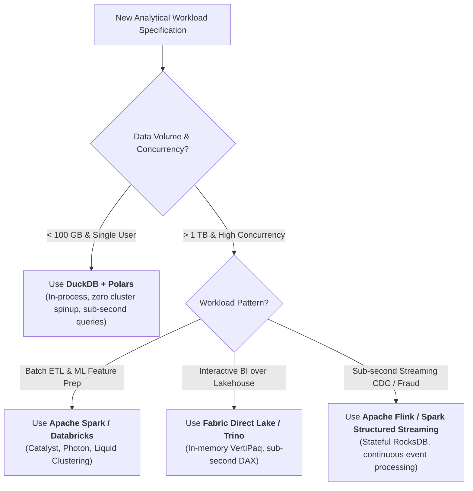

# Architecture Blueprints & Technical Deep-Dive Library

> **Authoritative Technical Guides & Enterprise Blueprints for Modern Lakehouse Systems**  
> Covering Azure Synapse, Microsoft Fabric, Modern NoSQL/Vector Databases, Streaming ETL, Lakehouse FinOps, Open Storage Formats, and Delta Lake Performance Optimization.

---

## 📚 Architectural Modules Directory

| Module | Title | Core Technologies | Focus & Key Takeaways | Link |
| :--- | :--- | :--- | :--- | :--- |
| **01** | **Azure Synapse Architecture Deep-Dive** | Dedicated SQL Pools, Serverless SQL, Managed VNet | MPP architecture, 60 hash distributions, Workload Management (WLM), HTAP Synapse Link. | [`01_azure_synapse.md`](./01_azure_synapse.md) |
| **02** | **Microsoft Fabric Architecture Mastery** | OneLake, Direct Lake, Shortcuts, F-SKU Capacity | SaaS lakehouse convergence, VertiPaq memory mapping, capacity smoothing, and bursting curves. | [`02_microsoft_fabric.md`](./02_microsoft_fabric.md) |
| **03** | **Modern NoSQL & Vector Databases** | Cosmos DB, ScyllaDB, pgvector, Qdrant, Milvus | RU/s optimization, multi-region writes, vector embeddings, semantic search, and RAG architectures. | [`03_nosql_vector_db.md`](./03_nosql_vector_db.md) |
| **04** | **Modern ETL/ELT & Stream Processing** | Spark, Flink, DuckDB, Polars, Delta UniForm | In-process analytical de-clustering, Apache Arrow zero-copy memory, real-time CEP vs micro-batching. | [`04_etl_stream_proc.md`](./04_etl_stream_proc.md) |
| **05** | **Lakehouse FinOps & Cloud Cost Optimization** | Databricks System Tables, Storage Lifecycle, Spot VMs | TCO models, Serverless SQL auto-scaling, Spot instance arbitrage, and cold data lifecycle policies. | [`05_lakehouse_finops.md`](./05_lakehouse_finops.md) |
| **06** | **Enterprise Blueprints & Failure Playbooks** | End-to-End Enterprise Lakehouse Blueprints | 6 production walkthroughs with Mermaid sequence flows, failure modes, and debugging playbooks. | [`06_enterprise_blueprints.md`](./06_enterprise_blueprints.md) |
| **07** | **Open Format Storage Types Reference** | Delta Lake, Apache Iceberg, Apache Hudi, Paimon | Lakehouse metadata snapshot trees, ACID OCC, hidden partitioning, Parquet/ORC/Avro physical layouts. | [`07_open_storage_formats.md`](./07_open_storage_formats.md) |
| **08** | **6 Delta Lake Optimization Levers** | Liquid Clustering, Z-Order, OPTIMIZE, VACUUM | Benchmarking 6 Delta Lake performance and storage hygiene levers across a 50M-row dataset. | [`08_delta_optimization.md`](./08_delta_optimization.md) |
| **Data** | **Unified Machine-Readable JSON Export** | Full Dataset JSON (`knowledge_base_export.json`) | Machine-readable export with metadata, schema tags, questions, and code snippets for SSGs and RAG. | [`knowledge_base_export.json`](./knowledge_base_export.json) |

---

## 🧭 Architectural Decision Tree: Format & Engine Selection

---

[← Back to Central Documentation Hub](../README.md)
