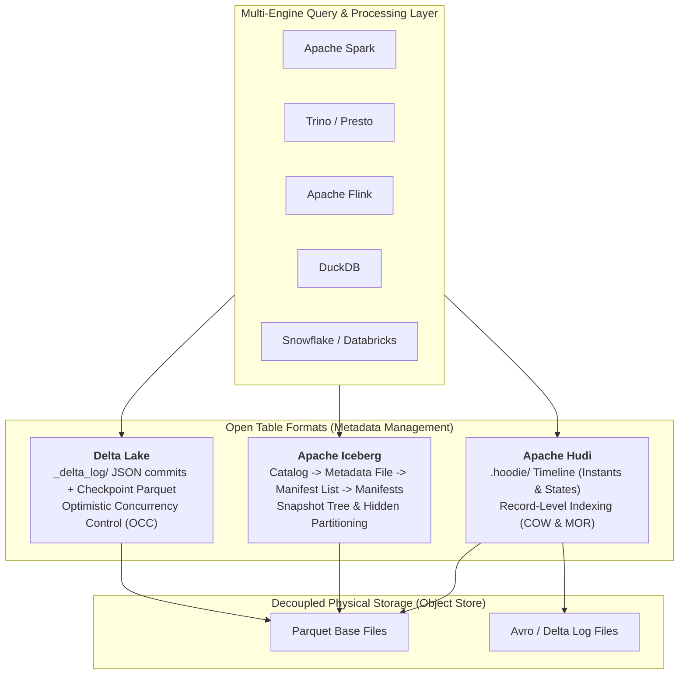
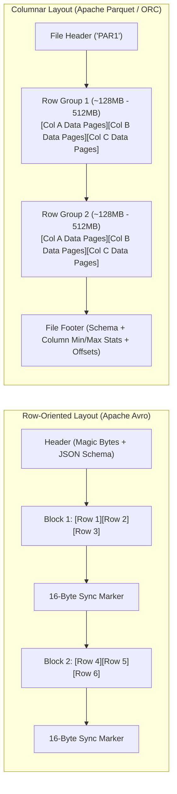
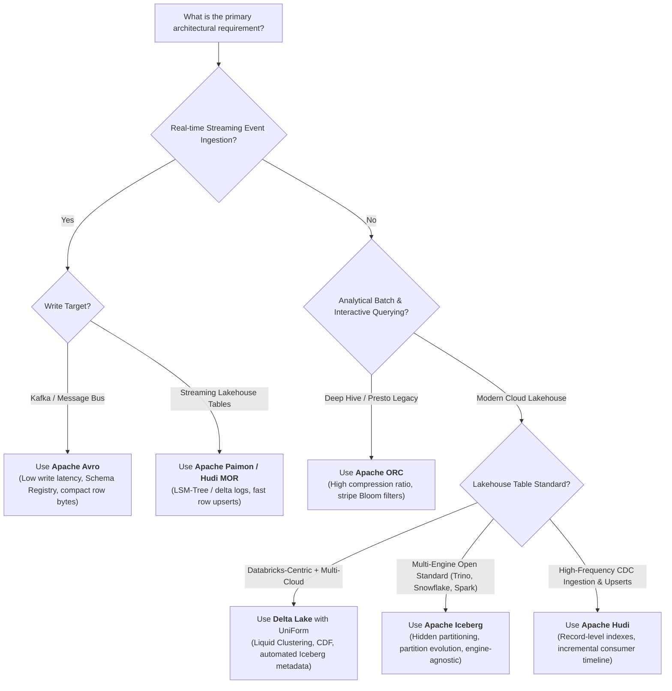

# Open Format Storage Types: Architecture Blueprints & Deep-Dive Reference

Open storage formats form the foundation of modern decoupled Lakehouse architectures, breaking proprietary database lock-in by standardizing **how bytes are organized on disk** (Physical File Formats) and **how collections of files are tracked as ACID-compliant relational tables** (Open Table Formats).

This guide provides deep-dive architectural blueprints and technical mechanics for both layers:
1. **Open Table Formats (Lakehouse Metadata Layer)**: Delta Lake, Apache Iceberg, Apache Hudi, and Apache Paimon.
2. **Open File Formats (Physical Storage Layer)**: Apache Parquet, Apache ORC, and Apache Avro.

---

## 1. Open Table Formats: Lakehouse Metadata Layer

Open table formats abstract object storage (S3, ADLS Gen2, GCS) into reliable SQL tables supporting ACID transactions, time travel, schema evolution, and fine-grained data skipping across heterogeneous compute engines (Spark, Trino, Flink, DuckDB, Snowflake).




---

### A. Delta Lake

#### 1. Architecture & Internal Metadata Hierarchy
Delta Lake utilizes an append-only transaction log located within the table directory under `_delta_log/`:
* **Commit Files (`00000000000000000000.json`)**: Every commit creates a zero-padded JSON file detailing state changes: added files, removed files, schema changes, and file statistics (min/max values, null counts per column).
* **Checkpoints (`*.checkpoint.parquet`)**: Every 10 commits by default, Delta collapses historical commits into a single compacted Parquet checkpoint file. Engines reading the table load the latest checkpoint and replay only subsequent JSON logs to construct the table snapshot in memory in milliseconds.
* **Storage Structure**:
  ```text
  my_table/
  ├── _delta_log/
  │   ├── 00000000000000000000.json
  │   ├── 00000000000000000001.json
  │   ├── ...
  │   ├── 00000000000000000010.checkpoint.parquet
  │   └── _last_checkpoint
  ├── part-00000-xyz.c000.snappy.parquet
  └── part-00001-abc.c000.snappy.parquet
  ```

#### 2. Concurrency & Transaction Protocol
* **Optimistic Concurrency Control (OCC)**: Writes assume no conflicting operations. At commit time, the engine checks whether files modified or referenced by the current transaction were changed by a concurrently committed transaction.
* **Isolation Levels**: Supports `WriteSerializable` (default) and full `Serializable`.
* **Conflict Resolution**: If two transactions append simultaneously, the second transaction reconciles by replaying the first transaction's commit and updating its commit version monotonically.

#### 3. Key Differentiators & Performance Optimizations
* **Liquid Clustering**: Replaces static Hive-style directory partitioning and manual Z-Ordering with incremental clustering. Adapts dynamically to query patterns without data rewrite overhead or data skew problems.
* **Universal Format (UniForm)**: Automatically generates Apache Iceberg and Apache Hudi metadata asynchronously upon Delta Lake commits. Allows Delta tables to be read natively by Iceberg-only or Hudi-only query clients without duplicating data files.
* **Change Data Feed (CDF)**: Emits row-level insert, update (pre-image and post-image), and delete events directly from the transaction log for streaming downstream consumers.

---

### B. Apache Iceberg

#### 1. Architecture & Snapshot Tree Hierarchy
Iceberg is catalog-centric and completely decouples table state from physical directory layouts. It models table state as a multi-tier tree:
1. **Catalog**: Pointers point to the current **Metadata File** (e.g., Nessie, AWS Glue, Unity Catalog, REST Catalog).
2. **Metadata File (`v<N>.metadata.json`)**: Contains the table schema, partition specification, snapshot log, and points to the current active snapshot.
3. **Manifest List (`snap-<id>.avro`)**: Represents a specific snapshot. Lists all manifest files participating in that snapshot along with partition summaries and partition-level min/max stats.
4. **Manifest Files (`<id>.avro`)**: Individual manifests listing physical data files, file paths, status (`ADDED`, `EXISTING`, `DELETED`), column-level metrics (min/max, null counts, NaN counts).
5. **Data Files**: Actual physical columnar files (`.parquet`, `.orc`, or `.avro`).

```text
Catalog Pointer -> v3.metadata.json
                       │
                 Snapshot-101
                       │
            snap-101.avro (Manifest List)
             ├── manifest-A.avro (Partition: 2026-Q1) -> [data-1.parquet, data-2.parquet]
             └── manifest-B.avro (Partition: 2026-Q2) -> [data-3.parquet]
```

#### 2. Key Innovations
* **Hidden Partitioning**: Query engines do not require explicit partition columns in queries. Iceberg applies partition transforms (e.g., `days(event_time)`, `bucket(16, user_id)`) transparently. If a query filters on `event_time >= '2026-10-01'`, Iceberg prunes partition manifests automatically without exposing synthetic partition columns.
* **Partition Evolution**: Partitioning schemes can be modified in-place (e.g., switching from monthly to daily partitioning) without rewriting existing data. New data is written using the new partition spec, while historical data remains indexed under the old spec.
* **Schema Evolution with Unique Field IDs**: Every column is assigned an immutable integer ID. Renaming, reordering, dropping, or adding columns never corrupts historical data files or confuses engines.
* **Row-Level Mutations (v2 Format)**:
  * **Copy-on-Write (COW)**: Rewrites entire data files upon update/delete. Optimizes read-heavy workloads.
  * **Merge-on-Read (MOR)**: Writes lightweight delete files alongside original data files:
    * *Positional Delete Files*: Lists specific file paths and row offsets to ignore.
    * *Equality Delete Files*: Specifies values of key columns that identify deleted records.

---

### C. Apache Hudi (Hadoop Upsert Delete and Incremental)

#### 1. Architecture & Timeline Metadata
Hudi was designed at Uber specifically to solve low-latency ingestion, CDC updates, and streaming upserts on distributed object storage.
* **Timeline (`.hoodie/`)**: Maintains a log of all actions executed on the table at distinct **Instants**:
  * **Instant Time**: Timestamp of the action (e.g., `20261015170000`).
  * **State**: `REQUESTED` $\rightarrow$ `INFLIGHT` $\rightarrow$ `COMPLETED`.
  * **Action**: `commit` (batch write), `deltacommit` (MOR delta write), `compaction` (reconciling log files into columnar base files), `clean` (reclaiming unused files), `rollback`, `savepoint`.

#### 2. Table Types & Write Mechanisms
* **Copy-on-Write (COW)**: Every update creates a new version of the Parquet base file containing the merged records. Maximum query read efficiency at the expense of write amplification.
* **Merge-on-Read (MOR)**: Updates are appended rapidly to row-based `.log.avro` delta files. Compactor background services merge delta files into new Parquet base files asynchronously.
* **Query Views**:
  * *Read Optimized View*: Reads only compacted Parquet base files (fastest, slight data staleness).
  * *Snapshot View*: Merges base files and delta logs on-the-fly (freshest data, higher compute overhead).
  * *Incremental View*: Queries only records that changed since a specific timeline instant.

#### 3. High-Performance Record Indexing
Hudi employs pluggable record-level indices that map `record_key` to physical `file_id`:
* **Bloom Filter Index**: Prunes candidate files using embedded Bloom filters before reading data.
* **Bucket Index**: Deterministic hashing assigns records to fixed file buckets (zero lookup overhead).
* **Global vs. Non-Global Indexing**: Enforces uniqueness across the entire table or strictly within partitions.

---

### D. Apache Paimon (Emerging Streaming Lakehouse)

* **LSM-Tree Storage Engine**: Adopts Log-Structured Merge-tree principles directly on cloud object storage.
* **Real-time Changelog Generation**: Serves high-frequency streaming upserts from Apache Flink with sub-minute latency.
* **Partial Updates & Aggregations**: Supports merging individual fields from multiple streaming sources into unified wide records without full table joins.

---

## 2. Open File Formats: Physical Storage Layer

Open file formats define the internal layout of bytes, serialization protocols, compression encodings, and index structures within individual files stored on disk.




---

### A. Apache Parquet

#### 1. Internal Anatomy & Physical Layout
Parquet uses Dremel-style nested data representation with a hybrid columnar structure:
* **Header**: Starts with 4-byte magic string `PAR1`.
* **Row Groups**: Logical horizontal partitions of rows, typically configured to 128 MB – 512 MB to match storage block sizes.
* **Column Chunks**: Within each row group, data for each column is stored contiguously in chunks.
* **Pages**: Column chunks are subdivided into ~1 MB pages:
  * *Data Pages*: Contains encoded values, definition levels, and repetition levels (handling nested arrays and maps).
  * *Dictionary Pages*: Stores unique value dictionaries for dictionary-encoded columns.
* **File Footer**: Written at the very end of the file. Contains table schema, metadata, row group offsets, and column chunk statistics (minimum/maximum values, null counts). Ends with 4-byte magic string `PAR1`.

#### 2. Read Acceleration & Compression
* **Column Projection**: When a query selects 3 out of 100 columns, the reader parses the footer, calculates the exact byte offsets, and streams only the byte ranges for those 3 column chunks. The remaining 97 columns are completely ignored at the I/O layer.
* **Predicate Pushdown**: Evaluates WHERE clauses (e.g., `age > 65`) against footer min/max statistics. If a row group's `max(age)` is 50, the entire row group is skipped without decompression or reading.
* **Encodings**:
  * *Dictionary Encoding*: Replaces repetitive strings with small integer keys.
  * *Run-Length Encoding (RLE)*: Compresses repeated contiguous values.
  * *Bit-Packing*: Stores small integers using the minimum required number of bits.

---

### B. Apache ORC (Optimized Row Columnar)

#### 1. Internal Anatomy & Stripe Architecture
Developed originally for the Hadoop/Hive ecosystem, ORC organizes data into large **Stripes** (typically 64 MB – 256 MB):
* **Postscript**: Located at the end of the file, containing compression block size and the length of the File Footer.
* **File Footer**: Contains table schema, stripe information, and file-level summary statistics.
* **Stripes**:
  * *Stripe Index*: Contains row groups of 10,000 rows. Includes min/max statistics and built-in **Bloom Filters** for each column.
  * *Column Data (Streams)*: Compressed byte streams segregated by column.
  * *Stripe Footer*: Contains column encodings and stream directory locations within the stripe.

#### 2. Key Differences from Parquet
* **Built-in Bloom Filters**: ORC allows point-lookup skipping within stripes via native Bloom filter indexes, skipping blocks of 10,000 rows without decompressing the stream.
* **Extreme Compression Density**: Employs integer run-length, variable-byte, and dictionary encodings tailored for high-volume enterprise data warehousing.

---

### C. Apache Avro

#### 1. Internal Anatomy & Row Serialization
Avro stores records contiguously in a binary row-oriented format:
* **Header**: Includes magic bytes `Obj\x01`, file metadata including the **complete JSON schema definition**, and a randomly generated **16-byte cryptographic sync marker**.
* **Data Blocks**: Each block contains:
  * Record count indicator.
  * Compressed byte length.
  * Serialized rows written sequentially.
  * The identical 16-byte sync marker, enabling split-readers (e.g., MapReduce or Spark) to locate block boundaries without reading the entire file.

#### 2. Schema Evolution Mechanics
* **Reader & Writer Schema Resolution**: Avro writes the full writer schema in the file header. When reading with a newer or older schema, Avro applies strict schema resolution rules:
  * Adding a column: Permitted if the column defines a default value.
  * Dropping a column: Permitted if the reader schema omits it.
  * Field aliases: Supports mapping renamed fields between versions.
* **Confluent Schema Registry**: In Kafka architectures, Avro payloads omit the schema in each message to save bytes, embedding a 4-byte Schema ID that points to a centralized Schema Registry.

---

## 3. Comprehensive Technical Comparison Matrix

### Table Formats Comparison

| Capability | Delta Lake | Apache Iceberg | Apache Hudi | Apache Paimon |
| :--- | :--- | :--- | :--- | :--- |
| **Primary Creator** | Databricks | Netflix / Apple | Uber | Alibaba / Apache |
| **Metadata Mechanism** | `_delta_log/` JSON log + Checkpoints | Hierarchical Snapshot Tree (Avro) | `.hoodie/` Timeline Instants | LSM-Tree File Levels |
| **Catalog Dependency** | Optional (Path-based or Catalog) | Required (Catalog is root pointer) | Optional (Path-based or Catalog) | Required |
| **Partitioning Strategy** | Directory-based / Liquid Clustering | Hidden Partitioning & Evolution | Directory-based / Virtual Keys | Bucket / Directory |
| **Schema Evolution** | Column mapping (ID-based) | Immutable Column ID-based | ID-based / Avro resolution | Type promotion / ID-based |
| **Row Mutations** | Copy-on-Write / In-place deletion | COW & MOR (Positional/Equality) | COW & MOR (Delta logs) | LSM-Tree Key Compaction |
| **Cross-Format Read** | UniForm (emits Iceberg/Hudi) | Read native | Read native | Read native |
| **Ideal Workloads** | Spark/Databricks, general Lakehouse | Multi-engine (Trino/Snowflake/Spark) | Streaming CDC, low-latency upserts | High-throughput streaming (Flink) |

### Physical File Formats Comparison

| Dimension | Apache Parquet | Apache ORC | Apache Avro |
| :--- | :--- | :--- | :--- |
| **Storage Layout** | Columnar (Row Groups $\rightarrow$ Chunks) | Columnar (Stripes $\rightarrow$ Streams) | Row-oriented (Sequential Data Blocks) |
| **Primary Focus** | OLAP analytical queries | Enterprise Data Warehousing | Streaming ingestion & CDC messaging |
| **Data Skipping Level** | Row Group & Page min/max stats | Stripe & 10,000-row group Bloom filters | None (must scan rows sequentially) |
| **Column Projection** | Native & highly efficient | Native & highly efficient | Inefficient (must deserialize full rows) |
| **Write Latency** | Moderate (buffers row groups in memory) | Moderate (buffers stripes in memory) | Extremely low (appends rows directly) |
| **Schema Storage** | Footer (thrift metadata) | Postscript & File Footer | Header (JSON schema string) |
| **Decompression Cost** | Low (decompresses queried columns only) | Ultra-low (stripe-level index skipping) | Higher for columnar aggregates |

---

## 4. Architectural Decision Tree: Choosing the Right Format



### Summary Recommendations
1. **Physical Files**: Use **Parquet** as the default storage format for all analytical data lakes. Reserve **Avro** for streaming message buses (Kafka) and raw event capture.
2. **Lakehouse Table Layer**:
   * Choose **Apache Iceberg** when operating across multiple query engines (Spark, Trino, Snowflake, DuckDB) where catalog abstraction and partition evolution are paramount.
   * Choose **Delta Lake** when Databricks or Microsoft Fabric forms the central compute core, leveraging **UniForm** to expose Iceberg endpoints without storage duplication.
   * Choose **Apache Hudi** when workloads involve high-volume CDC micro-batches requiring record-level bloom/bucket indexing and incremental consumption.
